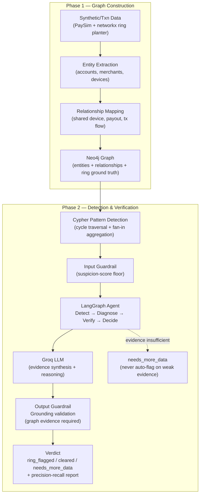

# Architecture

Two phases: graph construction, then detection & verification.

## Phase 1 — Graph Construction

| Step | File | What it does |
|---|---|---|
| Load | `src/data/load_paysim.py` | Reads `archive/paysim.csv`, validates schema, tightens dtypes, derives `orig_kind`/`dest_kind` (customer vs. merchant) from PaySim's `C`/`M` naming convention. |
| Plant | `src/data/plant_rings.py` | Builds a directed transaction graph from the loaded rows, then plants synthetic `shared_device`, `shared_payout`, and `circular_flow` rings (each at "obvious" and "subtle" difficulty) plus benign counterparts for all three methods, with account-disjoint calibration and test cohorts. This is the ground truth `eval/metrics.py` scores against. |
| Push | `src/data/build_graph.py` | UNWIND-batched writes into Neo4j: `(:Account {account_id, kind, device_id?})` nodes, `(:Account)-[:TRANSACTED_WITH {amount, step, type}]->(:Account)` for every transaction (PaySim + planted), `(:Account)-[:SHARES_PAYOUT]->(:Account)` derived from each shared_payout ring's actual planted legs. Cohort members and planted transactions carry `ring_id`, `ring_type`, `difficulty`, and `split`. Payout cohort members also store the labeled recipient. |

**Sampling matters here in a way that isn't obvious**: load with `--sample-frac`,
not `--nrows`. PaySim's rows are ordered by `step`; `--nrows N` takes the
first N rows, which only spans a handful of the dataset's 743 steps. That
collapses every transaction into a tiny time window — real and planted
activity alike — which silently breaks any time-window-based detection
signal in Phase 2. `--sample-frac` samples across the full timeline instead.

## Phase 2 — Detection & Verification

### Why Cypher pattern detection, not GDS

Generic community-detection algorithms (Louvain, WCC, and friends) are built
for a specific job: discovering *unknown* cluster structure in a large,
messy graph where you don't know what shape you're looking for. That's not
this problem. The three ring types here — closed transaction cycles,
shared-device clusters, payout fan-in — are targets we designed ourselves,
so their exact graph shape is known in advance. When the shape is known, a
hand-written Cypher pattern query that checks for that specific shape is
more precise, more interpretable, and easier to justify per match than a
black-box community-detection score would be. `src/detection/detection.py`
implements each ring type as a targeted, explainable check instead of a
generic clustering pass:

- **Shared device** groups accounts by device ID and scores their transaction frequency,
  common recipients, and repeat payments to those recipients.
- **Shared payout** finds personal-account transfer windows and scores unique senders,
  repeated senders, transfer frequency, and the size of the time window.
- **Circular flow** finds simple directed transfer cycles in chronological order within
  72 hours. It scores amount similarity (30%), average time between hops (20%),
  non-overlapping repeats (20%), and consistency of successive amount ratios (30%).
  Flat amounts and a steady proportional decrease both receive full ratio credit.

### The agent: detect → diagnose → verify → decide

`src/agent/` wires four stages with LangGraph:

1. **detect** (`nodes.py::detect_node`) — the input guardrail: candidates
   below a suspicion-score floor never reach the LLM at all.
2. **diagnose** (`nodes.py::diagnose_node`) — a Groq LLM call (`openai/gpt-oss-120b`,
   temperature 0.1) reasons over the candidate's graph evidence and produces
   a freeform analysis citing specific fields.
3. **verify** (`nodes.py::verify_node`) — the output guardrail: a second,
   structured-output Groq call fact-checks the diagnosis against the graph
   evidence (and only the graph evidence — see `guardrails.py`), flagging
   any claim that isn't actually grounded.
4. **decide** (`nodes.py::decide_node`) — combines the grounding result with
   the diagnosis's own judgment into a final verdict. Grounded-but-thin
   evidence (nothing hallucinated, but not enough to act on) still resolves
   to `needs_more_data` via a per-method evidence-sufficiency floor, not
   just an ungrounded diagnosis — see `src/eval/report.md`'s worked example
   for what that looks like on real data.

Verdicts: `ring_flagged`, `cleared`, or `needs_more_data`. The governing
rule: insufficient evidence always resolves to `needs_more_data`, never an
unsupported flag.

### Evaluation

`src/eval/metrics.py` fits a flag floor per method with calibration cohorts and
runs one representative per matched held-out cohort through the agent. The report
shows candidate precision and recall, detector and verdict recall over all held-out
positive rings, and coverage for each hard-negative scenario. [Evaluation protocol](docs/EVALUATION.md)

### Running it

`main.py` chains build_graph → detection → metrics → report into one
command (see README.md's Quickstart) by calling each module's own `main()`
with the same defaults documented there -- it's a convenience wrapper, not a
separate code path; each step is equally runnable on its own via
`uv run python -m src.<...>` for more visibility into an individual stage.
