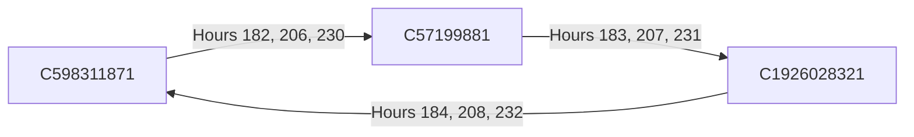

# Neo4j and agent demo

## Run the pipeline

Use a dedicated Neo4j database and the PaySim CSV described in [Data](DATA.md).
Set the connection details and Groq key in `.env` using `.env.example`.

```bash
uv sync
uv run python -X utf8 main.py --runs 1 --stability-runs 0
```

This selects about 100,000 PaySim transactions with seed 42, plants the labeled
cohorts, runs detection and calibration, and sends one representative per matched
held-out cohort through diagnosis, grounding verification, and verdict. The pipeline
clears the configured database before loading. For the default repeated evaluation,
run `uv run python -X utf8 main.py --skip-build` on the loaded graph.

The reference graph produced 180 raw detections, including matches for 29 of 30
held-out positive rings and all 15 hard negatives. The missed cycle
`circular_flow-subtle-084` spanned 80 hours, above the 72-hour cycle limit.
Groq completed all 44 candidate runs. It flagged 29 positives and 12 hard
negatives, giving 70.7% candidate precision and 96.7% ring verdict recall.

## Inspect the graph in Neo4j Browser

Paste the following query and select **Graph** in the result. It draws one complete
held-out cycle and retains the transaction amount and hour on each edge.

```cypher
MATCH (a:Account)
WHERE a.split = 'test' AND a.ring_type = 'circular_flow' AND a.difficulty = 'obvious'
WITH a.ring_id AS cohort ORDER BY cohort LIMIT 1
MATCH (sender:Account)-[r:TRANSACTED_WITH]->(recipient:Account)
WHERE r.ring_id = cohort
RETURN sender, r, recipient
```

The seeded run returned `circular_flow-obvious-067`. Each arrow carried
1,101,965.62 per transfer. The detector counted three separate laps and
the agent returned `ring_flagged`.



Run this comparison to see why personal transfers also produce payout candidates.

```cypher
MATCH (sender:Account)-[r:TRANSACTED_WITH]->(recipient:Account)
WHERE r.split = 'test' AND r.ring_type IN ['shared_payout', 'legit_personal_transfers']
WITH r.ring_id AS cohort, r.ring_type AS scenario, recipient,
     count(DISTINCT sender) AS unique_senders, count(r) AS transfers,
     max(r.step) - min(r.step) AS elapsed_hours
RETURN scenario, cohort, recipient.account_id AS recipient, unique_senders, transfers, elapsed_hours
ORDER BY scenario, cohort
```

For example, the benign cohort `legit_personal_transfers-benign-107` matched
three distinct senders and three transfers within three hours.

## Trace a candidate to a verdict

Open [the report](../src/eval/report.md#worked-examples) to compare a positive ring
and a known benign candidate. Each example includes its detector evidence, the
Groq diagnosis, the verifier result, and the final verdict. In
[`eval_results.json`](../src/eval/eval_results.json), each record also includes the
candidate's accounts and run outcomes. To draw a specific example, paste its
report `ring_id` into this query.

```cypher
WITH 'your-ring-id' AS cohort
MATCH (sender:Account)-[r:TRANSACTED_WITH]->(recipient:Account)
WHERE r.ring_id = cohort
RETURN sender, r, recipient
```
